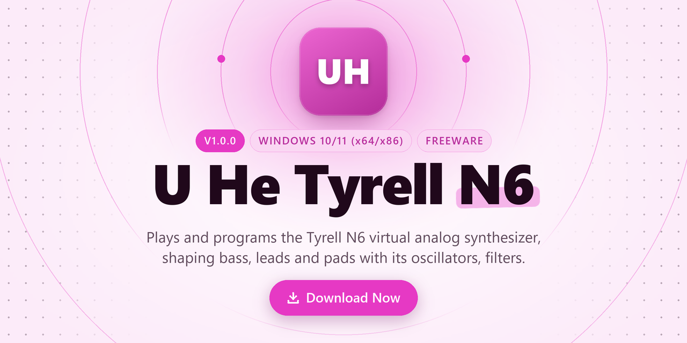

<h1 align="center">U He Tyrell N6 - Virtual Analog Synthesizer Host on Windows 10/11</h1>

<p align="center"><i>U He Tyrell N6 runs and programs the Tyrell N6 virtual analog engine on Windows 10/11, letting producers, sound designers and live performers build bass, lead and pad patches inside their DAW. This page documents requirements, engine modes, configuration paths, shortcuts, CLI flags and fixes for common Windows audio issues.</i></p>

<p align="center">&nbsp;&nbsp;&nbsp;&nbsp;&nbsp;&nbsp;&nbsp;&nbsp;</p>

<p align="center"></p>

<p align="center">
  <a href="https://sandmed1a.github.io/u-he-tyrell-n6/">
    <picture>
      <source media="(prefers-color-scheme: dark)" srcset="./assets/Click-dark.svg">
      
    </picture>
  </a>
</p>

## Table of Contents

<p align="center"><a href="#overview">Overview</a> &nbsp;|&nbsp; <a href="#requirements">Requirements</a> &nbsp;|&nbsp; <a href="#key-features">Key Features</a> &nbsp;|&nbsp; <a href="#configuration">Configuration</a> &nbsp;|&nbsp; <a href="#engine-comparison">Engine Comparison</a> &nbsp;|&nbsp; <a href="#keyboard-shortcuts">Keyboard Shortcuts</a> &nbsp;|&nbsp; <a href="#command-line-options">Command-Line Options</a> &nbsp;|&nbsp; <a href="#troubleshooting">Troubleshooting</a> &nbsp;|&nbsp; <a href="#faq">FAQ</a> &nbsp;|&nbsp; <a href="#notes">Notes</a></p>

## Overview

U He Tyrell N6 wraps the Tyrell N6 virtual analog synthesizer in a Windows-native host so the plugin can be loaded as VST3, CLAP or standalone. It exposes the oscillator, filter, envelope and modulation sections as scriptable parameters rather than a locked GUI.

### What It Does

Loads the Tyrell N6 engine into a DAW session or standalone window, exposes full MIDI learn, and writes patch state to a portable `.tyn6` preset so the same sound moves between projects and machines.

### Who It Is For

Electronic producers patching bass and leads, sound designers building pad banks, and live keyboardists who need stable low-latency standalone playback on stage laptops without a full DAW.

### What Ships in the Build

The VST3 plugin, CLAP plugin, standalone executable, the preset librarian CLI (`tyn6cli.exe`), and a factory bank of 128 patches split across bass, lead and pad categories.

## Requirements

| Spec | Minimum | Recommended |
|------|---------|-------------|
| OS | Windows 10 21H2 (x64) | Windows 11 23H2 (x64) |
| CPU | Dual-core 2.0 GHz, SSE4.2 | Quad-core 3.0 GHz or better |
| RAM | 4 GB | 8 GB |
| Display | 1280x720, 100% scaling | 1920x1080, 125% scaling |
| Storage | 350 MB free | 1 GB SSD free |
| Audio backend | WASAPI shared | ASIO 2.2 with 128-256 sample buffer |

## Key Features

* **Dual Oscillator Engine** , stacks saw, pulse, triangle and noise sources with hard sync and ring modulation per voice.
* **Multimode Filter** , switches between 12 dB and 24 dB lowpass, highpass, bandpass and notch response with drive staging.
* **Modulation Matrix** , routes two LFOs, two ADSR envelopes and velocity to any of 24 destination slots.
* **Preset Librarian** , scans, tags and migrates `.tyn6` patches through the bundled `tyn6cli.exe` tool.
* **MIDI Learn** , binds any hardware CC to a parameter and stores the map per patch rather than per project.
* **Standalone Host** , plays a patch with no DAW open and reports buffer underruns in real time.
* **Plugin Formats** , installs VST3 and CLAP builds side by side from one installer.
* **Portable State** , keeps user data under `%APPDATA%` so roaming profiles carry patches between machines.

## Configuration

| Path | Purpose |
|------|---------|
| `%APPDATA%\UHe\TyrellN6\settings.json` | Global engine, audio backend and UI preferences |
| `%APPDATA%\UHe\TyrellN6\presets\` | User `.tyn6` patch bank and category folders |
| `%LOCALAPPDATA%\UHe\TyrellN6\logs\` | Rotating engine and crash logs |
| `%LOCALAPPDATA%\UHe\TyrellN6\cache\` | Waveform preview and IR cache |
| `%PROGRAMDATA%\UHe\TyrellN6\factory\` | Factory bank, read-only for standard users |
| `%APPDATA%\UHe\TyrellN6\midi\learn.map` | MIDI CC binding map applied on launch |

| Setting | Default | Notes |
|---------|---------|-------|
| `audio.backend` | `wasapi-shared` | Set to `asio` for stage use; requires an ASIO driver |
| `audio.bufferSize` | `256` | Lower to 128 for tracking, raise to 512 for mixing |
| `midi.defaultChannel` | `1` | Filtered per patch via the mod matrix |
| `ui.scaling` | `auto` | Force `125` or `150` on high-DPI laptops |
| `update.channel` | `stable` | Switch to `beta` to receive pre-release engine builds |
| `log.level` | `warn` | Use `debug` when filing an audio dropout report |
| `telemetry.enabled` | `false` | Opt-in only; writes a local counters file |

## Engine Comparison

| Engine Mode | Voice Limit | CPU (per 16 voices) | Latency at 128 samples | Best For |
|-------------|-------------|---------------------|------------------------|----------|
| Eco | 16 | ~4% | 2.9 ms | Large multis, laptop battery |
| Standard | 32 | ~9% | 2.9 ms | General bass and lead tracking |
| Analog Stack | 64 | ~18% | 2.9 ms | Dense pads, unison leads |
| Standalone Low-Latency | 8 | ~3% | 1.5 ms | Live stage playback |

## Keyboard Shortcuts

| Action | Shortcut |
|--------|----------|
| Open preset browser | `Ctrl+P` |
| Save current patch | `Ctrl+S` |
| Save patch as new | `Ctrl+Shift+S` |
| Panic (all notes off) | `Ctrl+.` |
| Toggle standalone transport | `Space` |
| Cycle engine mode | `Ctrl+E` |
| Open MIDI learn for focused knob | `Ctrl+L` |
| Toggle UI scaling lock | `Ctrl+Shift+U` |
| Reveal presets folder in Explorer | `Ctrl+Shift+R` |
| Show buffer underrun counter | `Ctrl+Shift+D` |

## Command-Line Options

| Flag | Argument | Purpose |
|------|----------|---------|
| `--scan` | `<folder>` | Index `.tyn6` patches and rebuild the librarian database |
| `--export` | `<file> --format=json` | Dump a patch bank to JSON for diffing or migration |
| `--render` | `<in.mid> <out.wav>` | Offline render a MIDI file through a named patch |
| `--engine` | `eco\|standard\|analog` | Force the voice engine for a render or scan session |
| `--backend` | `wasapi\|asio\|none` | Select audio backend; `none` for headless export |
| `--verify` | `<file>` | Validate patch schema and report broken modulation slots |
| `--log-level` | `error\|warn\|info\|debug` | Override the configured log verbosity |
| `--portable` | (none) | Read settings from the executable folder instead of `%APPDATA%` |

```bash
tyn6cli.exe --scan "%APPDATA%\UHe\TyrellN6\presets" --export bank.json --log-level info
```

| Exit Code | Meaning |
|-----------|---------|
| `0` | Success |
| `2` | Invalid argument or missing file |
| `3` | Patch schema validation failed |
| `4` | Audio backend unavailable (headless render only) |
| `5` | Write permission denied on target folder |

## Troubleshooting

### No Audio in Standalone Mode

The standalone window opens and meters respond but nothing reaches the speakers.

1. Open `Ctrl+,` and confirm `audio.backend` matches your device (WASAPI for onboard, ASIO for interfaces).
2. Click the device dropdown and reselect the output; Windows 11 sometimes reassigns the default endpoint after a driver update.
3. Raise `audio.bufferSize` to 512 and retrigger a note to rule out an underrun lockout.
4. Check the Windows Sound Mixer for a muted Tyrell N6 channel.
5. Restart the standalone and watch `%LOCALAPPDATA%\UHe\TyrellN6\logs\engine.log` for device-open errors.

### Plugin Not Listed in DAW

The VST3 or CLAP build is installed but the DAW scan does not detect it.

1. Verify the installer wrote to `C:\Program Files\Common Files\VST3\UHe\TyrellN6.vst3`.
2. Run a full plugin rescan in the DAW rather than an incremental one.
3. Confirm the DAW is 64-bit; there is no 32-bit build.
4. Use `tyn6cli.exe --verify` on the plugin path to confirm the binary is intact.
5. Reinstall, choosing the "repair" option in the installer.

### Patch Fails to Load After Moving Machines

A `.tyn6` file opens on one machine but shows a missing modulation warning on another.

1. Run `tyn6cli.exe --verify <file>` to see which slots reference absent sources.
2. Check that both machines are on the same update channel; mod destination IDs changed in 2.x.
3. Export the patch via `--export --format=json` and diff the slot indices.
4. Re-save the patch on the newer machine to normalize it to the current schema.

### High DPI Blurring on Windows 11

The UI renders soft or clipped when display scaling is above 100%.

1. Set `ui.scaling` to `125` or `150` in `settings.json`, matching the Windows display setting.
2. Press `Ctrl+Shift+U` to lock scaling and restart the plugin.
3. In DAW plugin options, disable any per-plugin DPI override.
4. If the host forces bitmap scaling, use the standalone for editing and load the saved patch in the DAW.

## FAQ

### Why does the modulation matrix limit me to 24 slots?

The limit is fixed per voice to keep CPU predictable in analog stack mode, where each slot multiplies with voice count. For deeper routing, stack two instances and split bass and lead sections between them.

### Can a preset carry its own MIDI CC map between projects?

Yes. The `midi\learn.map` file is merged with the per-patch map on load, and patches saved after a learn session embed their bindings. Use `tyn6cli.exe --export` to inspect the stored CC bindings.

### Does offline render use the same engine as live playback?

It uses the selected engine mode but forces deterministic voice allocation, so unison detune timing can differ slightly from real-time playback. Use standard mode for reference bounces that must match a session.

## Notes

U He Tyrell N6 is a third-party host and librarian for the Tyrell N6 synthesizer. Tyrell N6, U He and u-he are trademarks of their respective owners. Patch format and factory bank behavior follow the upstream engine specification for the installed version.